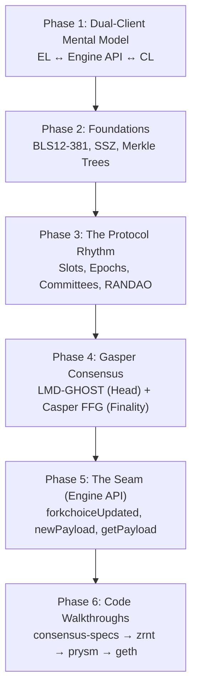
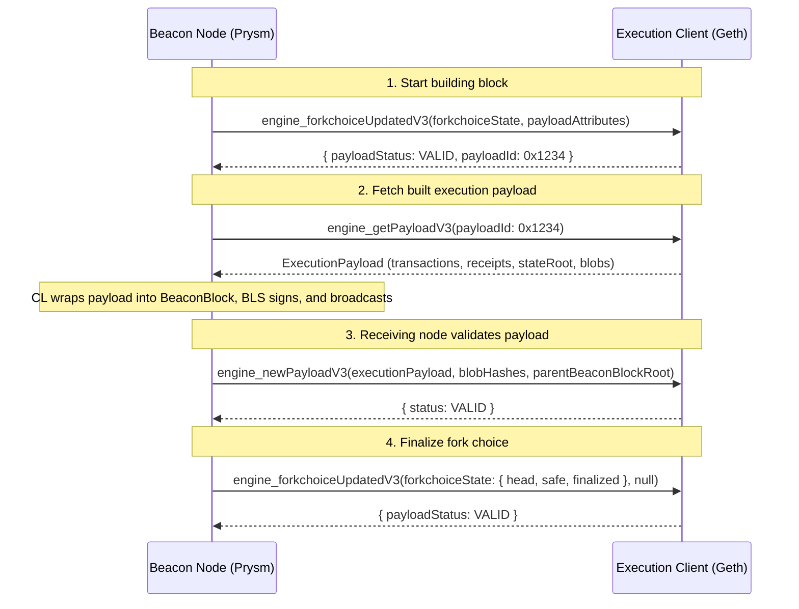

# ⟠ Ethereum Consensus Lab

Welcome to the **Ethereum Consensus Lab** — an environment for researching, exploring, and building on the **Ethereum Consensus Layer (Proof-of-Stake / Gasper)** and its interface with the **Execution Layer**.

---

## 📂 Project Structure & Repositories

This workspace contains the complete stack needed to explore both the theoretical specifications and the production implementations:

```
ethereumlab/
├── README.md                      # This project overview & study guide
├── guide.md                       # Detailed consensus layer study notes
├── ethereum-architecture.html     # Interactive architecture & 12-step consensus flow visualizer
├── gasper-lmd-ghost.html          # Interactive Gasper / LMD-GHOST fork choice simulator
├── goal.png / layer.png           # Architectural diagrams
│
├── consensus-specs/               # Canonical executable Python specs for Ethereum CL
│   └── specs/                     # phase0, altair, bellatrix, capella, deneb, electra
├── execution-apis/                # Engine API and EL JSON-RPC interface definitions
│   └── src/engine/                # engine_forkchoiceUpdated, engine_newPayload, etc.
├── prysm/                         # Production Go Consensus Layer client (Beacon Node + Validator)
├── zrnt/                          # Minimal, readable Go implementation of consensus specs
├── go-ethereum/                   # Execution Layer client (Geth) in Go
└── hive/                          # Ethereum integration & consensus test framework
```

### Interactive Visualizers (Zero External Dependencies)

Open these directly in your browser:
- **Full Architecture & End-to-End Consensus Flow:**
  ```bash
  open ethereum-architecture.html
  ```
  *Features:* Component breakdown, 12-step transaction-to-finality flow, 1-slot sequence diagram, 12-second slot timeline, and Casper FFG finality state machine.

- **Gasper & LMD-GHOST Fork Choice Simulator:**
  ```bash
  open gasper-lmd-ghost.html
  ```
  *Features:* Interactive fork tree, live vote modification, step-by-step GHOST execution, Gasper composition, and attack/defense scenarios (balancing, reorgs, long-range).

---

## 🧭 First Guide to Learning Ethereum Consensus

Post-Merge Ethereum separates consensus from execution. To understand how the chain works, follow this 6-phase curriculum:



---

### Phase 1: The Dual-Client Mental Model

A running Ethereum full node consists of two clients communicating via a secure JSON-RPC interface on port `8551` authenticated with a shared secret (`jwt.hex`):

```
+-----------------------------------+       Engine API        +-----------------------------------+
|      Execution Client (EL)        | <---------------------> |      Consensus Client (CL)        |
|          e.g., Geth               |        Port 8551        |          e.g., Prysm              |
+-----------------------------------+        (JWT Auth)       +-----------------------------------+
| • EVM bytecode execution          |                         | • PoS state transition (slots)   |
| • State trie (balances, storage)  |                         | • Fork choice (LMD-GHOST)         |
| • Transaction mempool             |                         | • Checkpoint finality (Casper)    |
| • devp2p (eth/68, snap)           |                         | • Validator management (BLS keys) |
| • RPC for users (port 8545)       |                         | • libp2p (GossipSub, req/resp)    |
+-----------------------------------+                         +-----------------------------------+
```

- **EL** does **not** decide what is canonical anymore. It runs transactions and computes state roots on command.
- **CL** is the **brain**: it tracks validators, determines the canonical head, and drives EL forward.

---

### Phase 2: Cryptographic & Data Foundations

Before reading consensus rules, understand the primitive building blocks:

| Primitive | What it is | Why Consensus uses it | Code Reference |
|---|---|---|---|
| **BLS12-381** | Pairing-friendly elliptic curve signatures | Allows **signature aggregation** (thousands of validator signatures combine into 1 constant-size 96-byte signature) | `consensus-specs/specs/phase0/beacon-chain.md#bls-signatures` |
| **SSZ (SimpleSerialize)** | Deterministic serialization format | Replaces RLP for the beacon chain. Provides native Merkleization, fixed-size offsets, and generalized Merkle proofs | `zrnt/eth2/beacon/common/ssz.go` |
| **Merkle Tree & Roots** | Binary Merkle tree over SSZ chunks | The entire `BeaconState` can be referenced by a single 32-byte `state_root`. Any field can be proven via a Merkle proof | `go-ethereum/beacon/merkle/` |

---

### Phase 3: The Protocol Rhythm

Ethereum consensus operates on strict clock intervals:

```
1 Slot = 12 seconds   (1 Block Proposal + Attestations)
1 Epoch = 32 slots    (~6.4 minutes = 1 Checkpoint)
```

```
Epoch N                                                         Epoch N+1
├─────────┬─────────┬─────────┬─────── ... ──────┬──────────┤   ├─────────┬──────
Slot 0    Slot 1    Slot 2    Slot 3             Slot 31        Slot 32
[Checkpoint]                                                    [Checkpoint]
```

- **Slots:** Every 12 seconds, a pseudorandom validator is selected via **RANDAO** to propose a block.
- **Committees:** The remaining active validators are shuffled into committees to attest to (vote on) the head block and checkpoint pairs.
- **Epoch Boundary:** Every 32 slots, the protocol evaluates justification and finalization, processes validator accounting (rewards, penalties, slashings), and rotates committees.

---

### Phase 4: Gasper = LMD-GHOST + Casper FFG

Gasper combines two algorithms into one protocol:

1. **LMD-GHOST (Latest Message Driven – Greediest Heaviest Observed SubTree)**
   - **Role:** Real-time fork choice rule.
   - **How it works:** Whenever there is a fork, start at the latest justified checkpoint and walk down the tree, picking the child branch that has the highest cumulative attestation weight from validators.
   - **Guarantee:** Liveness (the chain never stops producing heads).
   - **Code:** `consensus-specs/specs/phase0/fork-choice.md`

2. **Casper FFG (Friendly Finality Gadget)**
   - **Role:** Economic finality mechanism.
   - **How it works:** Validators vote on `source -> target` epoch checkpoints. When $\ge \frac{2}{3}$ of the total active stake votes for a link, the target checkpoint becomes **Justified**. When the subsequent checkpoint is justified, the previous one becomes **Finalized**.
   - **Guarantee:** Safety (reverting a finalized checkpoint requires slashing at least $\frac{1}{3}$ of all staked ETH, costing billions of dollars).
   - **Time to finality:** Typically 2 epochs (~12.8 minutes).

---

### Phase 5: The Seam — The Engine API

The communication loop between CL and EL is governed by three primary Engine API methods:



- **Spec Location:** `execution-apis/src/engine/`
- **Geth Implementation:** `go-ethereum/eth/catalyst/api.go`

---

### Phase 6: Code Walkthroughs Across Your Repos

When studying a specific consensus concept, trace it across these repos:

| Concept | Spec (`consensus-specs`) | Minimal Go (`zrnt`) | Production Go (`prysm`) | Execution (`go-ethereum`) |
|---|---|---|---|---|
| **Beacon State Transition** | `specs/phase0/beacon-chain.md` | `eth2/beacon/phase0/state.go` | `beacon-chain/core/state/` | — |
| **Fork Choice (LMD-GHOST)** | `specs/phase0/fork-choice.md` | `eth2/beacon/forkchoice/` | `beacon-chain/forkchoice/` | `beacon/light/head_tracker.go` |
| **Validator Processing** | `specs/phase0/validator.md` | `eth2/beacon/phase0/validator.go`| `beacon-chain/core/epoch/precompute/` | — |
| **Engine API Handler** | `execution-apis/src/engine/` | — | `beacon-chain/execution/` | `eth/catalyst/api.go` |
| **Blob Transactions (4844)**| `specs/deneb/beacon-chain.md` | — | `beacon-chain/core/blobs/` | `consensus/misc/eip4844/` |

---

## 🛠️ Quick Commands

### Build Geth
```bash
cd /Users/duckhue01/ethereumlab/go-ethereum
make geth
# Binary produced at: ./build/bin/geth
```

### Inspect the Executable Consensus Specs
```bash
cd /Users/duckhue01/ethereumlab/consensus-specs
# Phase 0 (PoS base spec)
ls specs/phase0/
# Bellatrix (The Merge)
ls specs/bellatrix/
# Deneb (EIP-4844 Blobs)
ls specs/deneb/
```

### Study Engine API definitions
```bash
cd /Users/duckhue01/ethereumlab/execution-apis
# Inspect Paris / Shanghai / Cancun Engine API specs:
ls src/engine/
```

---

## 📖 Consensus Terminology Reference

- **Slot (12s):** Time interval during which a block can be proposed and attested to.
- **Epoch (32 slots / 6.4m):** Time period ending with an accounting and finalization checkpoint.
- **Validator:** A participant who deposited 32 ETH, registered a BLS keypair, and performs attestation and proposal duties.
- **Attestation:** A combined vote casting an LMD-GHOST head vote and a Casper FFG `(source, target)` checkpoint vote.
- **Sync Committee:** 512 validators chosen every 256 epochs to sign block headers, allowing ultra-lightweight client synchronization.
- **Justified:** A checkpoint that has received $\ge \frac{2}{3}$ of active validator votes.
- **Finalized:** An irreversible checkpoint (its direct descendant checkpoint has been justified).
- **Inactivity Leak:** A mechanism where offline validators are progressively penalized if the chain fails to finalize for $>4$ epochs, reducing their stake until the online validators regain $\ge \frac{2}{3}$ supermajority.
- **Slashing:** Severe penalty destroying up to 100% of a validator's stake for provable malicious acts (double proposing, double attesting, or surround voting).

