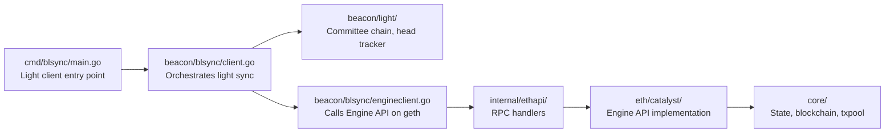
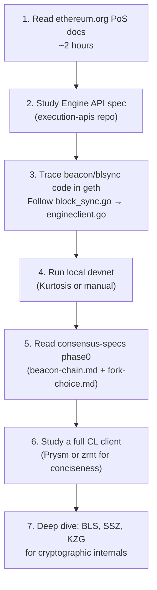

# Ethereum Consensus Layer — Learning Guide

> [!NOTE]
> Your workspace already has **go-ethereum** (geth), the execution layer client. The consensus layer (Beacon Chain) lives in a **separate** client that communicates with geth over the **Engine API** (JSON-RPC on port 8551). Both must run together post-Merge.

---

## 1. The Big Picture: Two Layers, One Chain

```mermaid
flowchart TD
    CL["Consensus Layer (Beacon Chain)\ne.g. Prysm, Lighthouse, Lodestar"]
    EL["Execution Layer (geth)\ngo-ethereum — already in your lab"]
    ENGINE["Engine API\nJWT-authenticated RPC :8551"]

    CL -->|"engine_forkchoiceUpdated\nengine_newPayload\nengine_getPayload"| ENGINE
    ENGINE --> EL

    subgraph Consensus Responsibilities
        direction TB
        V["Validators (BLS keys)"]
        A["Attestations"]
        BL["Block proposals (slots/epochs)"]
        FC["Fork choice (LMD-GHOST + Casper FFG)"]
    end

    subgraph Execution Responsibilities
        direction TB
        TX["Transaction ordering & EVM"]
        ST["State trie"]
        MP["Mempool"]
        P2P["devp2p (eth/68, snap)"]
    end

    CL --- Consensus Responsibilities
    EL --- Execution Responsibilities
```

---

## 2. What You Need to Learn (Ordered)

### 2.1 Foundations

| Topic | Why it matters | Where to start |
|---|---|---|
| **BLS12-381 signatures** | Validator keys, aggregation, slashing proofs | [EIP-2333](https://eips.ethereum.org/EIPS/eip-2333) |
| **SSZ (Simple Serialize)** | All beacon objects use SSZ, not RLP | [ssz.dev](https://ssz.dev) |
| **Merkle / Merkle Mountain Range** | `BeaconState` root, `LightClientUpdate` | `beacon/merkle/merkle.go` in your repo |
| **Slots & Epochs** | 12s slots, 32-slot epochs, sync committees | [ethereum.org/en/developers/docs/consensus-mechanisms/pos/](https://ethereum.org/en/developers/docs/consensus-mechanisms/pos/) |

### 2.2 Consensus Protocol

| Topic | Spec section |
|---|---|
| LMD-GHOST fork choice | [fork-choice.md](https://github.com/ethereum/consensus-specs/blob/dev/specs/phase0/fork-choice.md) |
| Casper FFG finalization | [casper-ffg paper](https://arxiv.org/abs/1710.09437) |
| Attestations & aggregation | [phase0/beacon-chain.md](https://github.com/ethereum/consensus-specs/blob/dev/specs/phase0/beacon-chain.md) |
| Sync committee (light client) | [altair/sync-protocol.md](https://github.com/ethereum/consensus-specs/blob/dev/specs/altair/light-client/sync-protocol.md) |
| Blob transactions (EIP-4844) | `consensus/misc/eip4844/` in your repo |

### 2.3 The Engine API (EL ↔ CL bridge)

> [!IMPORTANT]
> This is the most critical interface to understand — it's exactly what the `beacon/blsync/` code in your repo implements.

Key methods:
- `engine_forkchoiceUpdatedV3` — CL tells EL which block is head/safe/finalized
- `engine_newPayloadV3` — CL delivers a new execution payload to EL for validation
- `engine_getPayloadV3` — EL builds and returns a payload for the CL to propose

**Spec**: https://github.com/ethereum/execution-apis/blob/main/src/engine/

**In your repo**: [`beacon/blsync/engineclient.go`](file:///Users/duckhue01/ethereumlab/go-ethereum/beacon/blsync/engineclient.go)

### 2.4 Beacon Light Client (what `blsync` does)

Your repo's `cmd/blsync` is geth's **beacon light sync** — it tracks the canonical head from a beacon API without running a full CL node.

Key files:
- [`beacon/light/committee_chain.go`](file:///Users/duckhue01/ethereumlab/go-ethereum/beacon/light/committee_chain.go) — sync committee rotation
- [`beacon/light/head_tracker.go`](file:///Users/duckhue01/ethereumlab/go-ethereum/beacon/light/head_tracker.go) — canonical head tracking
- [`beacon/blsync/block_sync.go`](file:///Users/duckhue01/ethereumlab/go-ethereum/beacon/blsync/block_sync.go) — block-level sync logic
- [`beacon/types/beacon_block.go`](file:///Users/duckhue01/ethereumlab/go-ethereum/beacon/types/beacon_block.go) — data structures

---

## 3. Repos to Clone

```bash
# In your ethereumlab directory:
cd /Users/duckhue01/ethereumlab
```

### Priority 1 — Must have

| Repo | Why |
|---|---|
| `github.com/ethereum/consensus-specs` | The canonical spec — Python reference implementations, test vectors |
| `github.com/prysmaticlabs/prysm` | Most widely used Go CL client; pairs naturally with geth |
| `github.com/ethereum/execution-apis` | Engine API + Beacon API JSON-RPC spec |

```bash
git clone https://github.com/ethereum/consensus-specs --depth=1
git clone https://github.com/prysmaticlabs/prysm --depth=1
git clone https://github.com/ethereum/execution-apis --depth=1
```

### Priority 2 — Recommended

| Repo | Why |
|---|---|
| `github.com/ethereum/go-ethereum` (you have it) | EL — already cloned |
| `github.com/sigp/lighthouse` | Rust CL client; excellent docs and architecture notes |
| `github.com/ethereum/hive` | Integration test harness for EL+CL combos |
| `github.com/ethereum/kzg-ceremony-specs` | Understand KZG commitments used in EIP-4844 blobs |

```bash
git clone https://github.com/ethereum/hive --depth=1
git clone https://github.com/ethereum/kzg-ceremony-specs --depth=1
# lighthouse (Rust, large — optional)
git clone https://github.com/sigp/lighthouse --depth=1
```

### Priority 3 — Deep dive

| Repo | Why |
|---|---|
| `github.com/ethereum/annotated-spec` | Annotated, human-readable consensus spec |
| `github.com/ethereum/beacon-APIs` | OpenAPI spec for the Beacon REST API |
| `github.com/protolambda/zrnt` | Minimal Go consensus spec implementation (great for studying) |

```bash
git clone https://github.com/ethereum/beacon-APIs --depth=1
git clone https://github.com/protolambda/zrnt --depth=1
```

---

## 4. Building a Local Ethereum Testnet (EL + CL)

The standard local dev setup is **geth (EL) + Prysm (CL)** connected via Engine API.

### Option A — `ethereum-package` on Kurtosis (Easiest)

Kurtosis spins up a fully configured local devnet with one command:

```bash
# Install kurtosis
brew install kurtosis-tech/tap/kurtosis-cli

# Launch a local Ethereum network (geth + Prysm by default)
kurtosis run github.com/ethpandaops/ethereum-package
```

This starts geth + Prysm + a faucet + block explorer automatically.

---

### Option B — Manual geth + Prysm (Learn the most)

#### Step 1: Build geth

```bash
cd /Users/duckhue01/ethereumlab/go-ethereum
make geth
# binary at: ./build/bin/geth
```

#### Step 2: Build Prysm beacon-chain + validator

```bash
cd /Users/duckhue01/ethereumlab/prysm
go build -o build/beacon-chain ./cmd/beacon-chain
go build -o build/validator    ./cmd/validator
```

#### Step 3: Generate JWT secret (shared auth token)

```bash
mkdir -p /Users/duckhue01/ethereumlab/devnet
openssl rand -hex 32 > /Users/duckhue01/ethereumlab/devnet/jwt.hex
```

#### Step 4: Create genesis config

Use `el-cl-genesis-data` tooling or Prysm's `prysmctl`:

```bash
# Install prysmctl
go install github.com/prysmaticlabs/prysm/v5/cmd/prysmctl@latest

# Generate genesis
prysmctl testnet generate-genesis \
  --fork=capella \
  --num-validators=64 \
  --genesis-time-delay=15 \
  --output-ssz=/Users/duckhue01/ethereumlab/devnet/genesis.ssz \
  --chain-config-file=/path/to/chain-config.yaml \
  --geth-genesis-json-in=genesis.json \
  --geth-genesis-json-out=/Users/duckhue01/ethereumlab/devnet/genesis-el.json
```

#### Step 5: Initialize geth

```bash
cd /Users/duckhue01/ethereumlab/go-ethereum

./build/bin/geth init \
  --datadir /Users/duckhue01/ethereumlab/devnet/geth-data \
  /Users/duckhue01/ethereumlab/devnet/genesis-el.json
```

#### Step 6: Run geth (EL)

```bash
./build/bin/geth \
  --datadir /Users/duckhue01/ethereumlab/devnet/geth-data \
  --networkid 32382 \
  --http --http.api eth,net,web3,engine \
  --authrpc.addr localhost \
  --authrpc.port 8551 \
  --authrpc.vhosts localhost \
  --authrpc.jwtsecret /Users/duckhue01/ethereumlab/devnet/jwt.hex \
  --nodiscover
```

#### Step 7: Run Prysm beacon node (CL)

```bash
cd /Users/duckhue01/ethereumlab/prysm

./build/beacon-chain \
  --datadir /Users/duckhue01/ethereumlab/devnet/prysm-data \
  --min-sync-peers=0 \
  --genesis-state /Users/duckhue01/ethereumlab/devnet/genesis.ssz \
  --interop-eth1data-votes \
  --chain-config-file /path/to/chain-config.yaml \
  --contract-deployment-block=0 \
  --chain-id 32382 \
  --rpc-host=127.0.0.1 \
  --grpc-gateway-host=127.0.0.1 \
  --execution-endpoint http://localhost:8551 \
  --jwt-secret /Users/duckhue01/ethereumlab/devnet/jwt.hex \
  --accept-terms-of-use \
  --suggested-fee-recipient=0x0000000000000000000000000000000000000000
```

#### Step 8: Run Prysm validator (produces blocks)

```bash
./build/validator \
  --datadir /Users/duckhue01/ethereumlab/devnet/validator-data \
  --interop-num-validators=64 \
  --interop-start-index=0 \
  --force-clear-db \
  --chain-config-file /path/to/chain-config.yaml \
  --accept-terms-of-use
```

---

### Option C — `geth --dev` (Quickest, EL only)

No CL needed — geth mines blocks internally using the `--dev` flag. Good for EVM/contract testing, **not** for consensus layer study.

```bash
./build/bin/geth --dev --http --http.api eth,net,web3
```

---

## 5. Key Code Entry Points in Your `go-ethereum`



| File | What it does |
|---|---|
| [`eth/catalyst/api.go`](file:///Users/duckhue01/ethereumlab/go-ethereum/eth/catalyst/api.go) | Engine API handler (`engine_newPayload`, `engine_forkchoiceUpdated`) |
| [`consensus/beacon/consensus.go`](file:///Users/duckhue01/ethereumlab/go-ethereum/consensus/beacon/consensus.go) | PoS consensus rules for EL-side validation |
| [`beacon/types/beacon_block.go`](file:///Users/duckhue01/ethereumlab/go-ethereum/beacon/types/beacon_block.go) | `BeaconBlock` and `ExecutionPayload` types |
| [`beacon/light/committee_chain.go`](file:///Users/duckhue01/ethereumlab/go-ethereum/beacon/light/committee_chain.go) | Sync committee verification |
| [`miner/`](file:///Users/duckhue01/ethereumlab/go-ethereum/miner) | Payload building (EL side of block production) |

---

## 6. Learning Path (Suggested Order)



---

## 7. Quick Reference: Consensus Terminology

| Term | Meaning |
|---|---|
| **Slot** | 12-second time unit; one block opportunity |
| **Epoch** | 32 slots (6.4 min); finality checkpoint boundary |
| **Validator** | Entity with 32 ETH staked; proposes/attests blocks |
| **Attestation** | Vote for a block; aggregated by aggregators |
| **Sync Committee** | 512 validators serving light-client proofs for 256 epochs |
| **LMD-GHOST** | Fork choice: follow the "Greediest Heaviest Observed SubTree" |
| **Casper FFG** | Finality gadget; requires 2/3 supermajority to finalize |
| **Justified / Finalized** | Checkpoint states; finalized = irreversible |
| **ExecutionPayload** | The EL block embedded inside a `BeaconBlockBody` |
| **Engine API** | JWT-secured RPC between CL and EL (port 8551) |
| **BLS12-381** | Elliptic curve used for validator signatures; allows aggregation |
| **SSZ** | Simple Serialize — binary encoding for all beacon objects |
| **KZG commitment** | Polynomial commitment for blob data (EIP-4844) |
