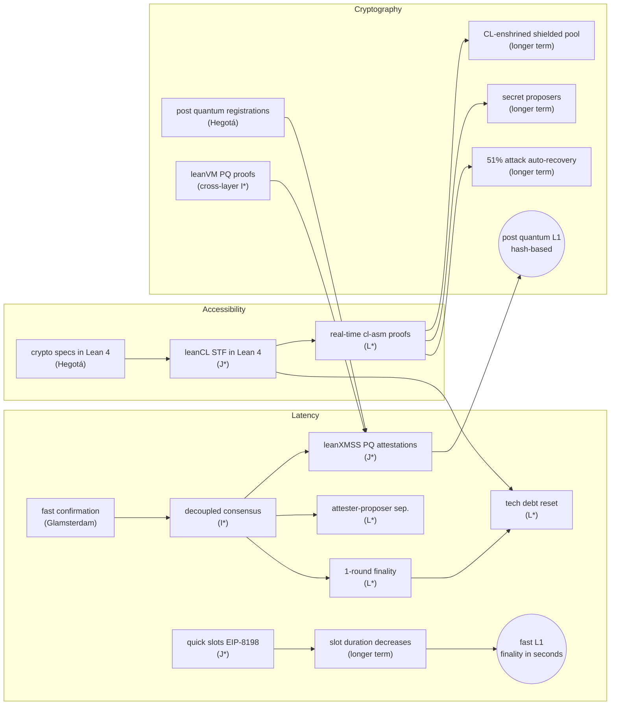

# Ethereum Consensus

> Deep-dive technical analysis grounded in the **L1 Strawmap — Ethereum Draft Roadmap** ([strawmap.org](https://strawmap.org)) and its component hyperlinks, mapped directly against the specifications and client codebases in this workspace ([consensus-specs](./consensus-specs), [prysm](./prysm), [lighthouse](./lighthouse), [zrnt](./zrnt), and [beacon-APIs](./beacon-APIs)).

---

## 1. Executive Overview: The Consensus Layer on the Strawmap

On the L1 Strawmap (updated Nov 2, 2026), the **Consensus Layer (CL)** occupies the top amber-and-green band spanning **3 themes**, **6 sub-rows**, **20 CL components**, and **1 cross-layer zkVM dependency** (`leanVM PQ proofs`), converging toward two CL North Stars:

- **`fast L1` (`finality in seconds`)** — reducing confirmation and finality from ~12.8–16 minutes toward single-slot / few-second guarantees.
- **`post quantum L1` (`hash-based`)** — migrating signatures, commitments, randomness, and state proofs away from elliptic curves (`BLS12-381`, KZG) to hash-based cryptography (`leanXMSS`, `leanVM`, `cl-asm`).

### Fork Horizon & Upgrade Governance

| Fork | Target Status | Canonical Meta / Tracker | Key CL Components on Strawmap |
| :--- | :--- | :--- | :--- |
| **Glamsterdam** (`G*`) | Active Dev / Testnet (Gloas CL) | [forkcast.org/upgrade/glamsterdam/](https://forkcast.org/upgrade/glamsterdam/), [EIP-7773](https://eips.ethereum.org/EIPS/eip-7773) | `fast confirmation` (non-HF), `ePBS` (**SFI**, EIP-7732) |
| **Hegotá** (`H*`) | Next Planned Upgrade (Heze CL) | [forkcast.org/upgrade/hegota/](https://forkcast.org/upgrade/hegota/) | `FOCIL` (**SFI**, EIP-7805), `cryptography specs in Lean 4`, `post quantum registrations` (`⚛`) |
| **`I*`** | Research / Scoping | — | `decoupled consensus`, `tapered issuance burn` (EIP-8363, `🤔`), `leanVM PQ proofs` (cross-layer `⚛`) |
| **`J*`** | Research / Feature Prototyping | — | `quick slots` (EIP-8198), `leanCL STF in Lean 4`, `leanXMSS PQ attestations` (`⚛`) |
| **`K*`** | Research Horizon | — | Transition bridge between `J*` and `L*` |
| **`L*`** | Major Architecture Reset | — | `1-round finality`, `attester-proposer separation` (`🤔`), `tech debt reset`, `real-time cl-asm proofs` |
| **`longer term`** | End-State R&D | — | `slot duration decreases`, `return to 1M attesters` (`🤔`), `distributed block building`, `51% attack auto-recovery`, `secret proposers`, `CL-enshrined shielded pool` |

> **Legend:** `SFI` = Scheduled for Inclusion · `⚛` = Quantum-resistance / post-quantum milestone · `🤔` = Open research / design debate.

---

## 2. Current CL Implementation Baseline in This Workspace

Understanding where the roadmap starts requires looking at what is already specified and implemented in this repository across mainnet (`Phase0`–`Fulu`) and next-fork development branches (`Gloas`, `Heze`, `FCR`, `_features/`).

### 2.1 Production Mainnet Baseline (`Phase0` through `Fulu`)

In [consensus-specs/configs/mainnet.yaml](./consensus-specs/configs/mainnet.yaml), mainnet has activated forks through **`Fulu`** (`FULU_FORK_EPOCH: 411392`, Dec 3, 2025). Core parameters across [phase0.yaml](./consensus-specs/presets/mainnet/phase0.yaml), [electra.yaml](./consensus-specs/presets/mainnet/electra.yaml), and [fulu.yaml](./consensus-specs/presets/mainnet/fulu.yaml) define the baseline the Strawmap seeks to transform:

| Dimension | Current Mainnet Implementation (`Fulu`) | Concrete Parameters & Local Files |
| :--- | :--- | :--- |
| **Slot & Epoch Timing** | Fixed 12-second slots, 32 slots/epoch (6.4 min/epoch). | `SLOT_DURATION_MS: 12000`, `SLOTS_PER_EPOCH: 32`, `ATTESTATION_DUE_BPS: 3333` (4s), `AGGREGATE_DUE_BPS: 6667` (8s) in [mainnet.yaml](./consensus-specs/configs/mainnet.yaml). |
| **Consensus & Finality** | **Gasper**: LMD-GHOST fork choice ([phase0/fork-choice.md](./consensus-specs/specs/phase0/fork-choice.md)) + 2-round **Casper FFG** justification/finalization (~12.8 min best case, ~16 min expected). | Implemented in [prysm/beacon-chain/forkchoice/doubly-linked-tree](./prysm/beacon-chain/forkchoice/doubly-linked-tree), [lighthouse/consensus/fork_choice/src/fork_choice.rs](./lighthouse/consensus/fork_choice/src/fork_choice.rs), and [zrnt/eth2/forkchoice/forkchoice.go](./zrnt/eth2/forkchoice/forkchoice.go). |
| **Committee & Stake Model** | `1/32` of active validators attest per slot across up to 64 committees (`TARGET_COMMITTEE_SIZE: 128`, `MAX_VALIDATORS_PER_COMMITTEE: 2048`), with MaxEB raised to `2048 ETH` in Electra. | `MIN_ACTIVATION_BALANCE: 32000000000` (32 ETH), `MAX_EFFECTIVE_BALANCE_ELECTRA: 2048000000000` (2048 ETH) in [electra.yaml](./consensus-specs/presets/mainnet/electra.yaml). |
| **Signatures & Hashing** | Aggregatable **BLS12-381** signatures via `blst` (`SHA-256` state/SSZ hashing). | Implemented in [prysm/crypto/bls/blst](./prysm/crypto/bls/blst) and [lighthouse/crypto/bls/src/impls/blst.rs](./lighthouse/crypto/bls/src/impls/blst.rs). |
| **Block Proposal & MEV** | Single proposer bundles execution payload inline; MEV-Boost relies on out-of-protocol trusted relays. Fulu added deterministic proposer lookahead (`EIP-7917`) and PeerDAS (`EIP-7594`, `NUMBER_OF_COLUMNS: 128`). | [specs/fulu/beacon-chain.md](./consensus-specs/specs/fulu/beacon-chain.md) (`ProposerLookahead`, `BlobParameters`) and [fulu.yaml](./consensus-specs/presets/mainnet/fulu.yaml). |
| **Light Clients** | Relies on a 512-validator **Sync Committee** rotated every 256 epochs (`SYNC_MESSAGE_DUE_BPS`, `CONTRIBUTION_DUE_BPS`) rather than ZK proofs of the full STF. | [mainnet.yaml](./consensus-specs/configs/mainnet.yaml). |

### 2.2 Next-Fork & Feature Readiness in Workspace

This workspace is notably ahead of mainnet: **both `consensus-specs` and two major clients (`Prysm` and `Lighthouse`) already have substantial `Gloas` (Glamsterdam), `Heze` (Hegotá), and `FCR` codebases**, while `zrnt` stops at `Electra` (with `fulu` YAML configs).

- **`consensus-specs`:** Full draft specs exist for [specs/gloas/](./consensus-specs/specs/gloas) (ePBS + `fast-confirmation.md`), [specs/heze/](./consensus-specs/specs/heze) (FOCIL + EIP-8015 + EIP-8365), plus exploratory feature specs under [specs/_features/](./consensus-specs/specs/_features) including `eip8198` (Quick Slots), `eip8025` (Execution Proofs), `eip8321` (Hash-Chain PQ RANDAO), `eip7716` (Anti-Correlation Penalties), `eip8148`, and `eip8205`.
- **`Prysm`:** Implements FCR ([confirmation.go](./prysm/beacon-chain/confirmation/confirmation.go)), Gloas state/forkchoice/blockchain ([core/gloas](./prysm/beacon-chain/core/gloas), [blockchain/gloas.go](./prysm/beacon-chain/blockchain/gloas.go), [doubly-linked-tree/gloas.go](./prysm/beacon-chain/forkchoice/doubly-linked-tree/gloas.go)), and early Heze upgrade/API types ([core/heze/upgrade.go](./prysm/beacon-chain/core/heze/upgrade.go), [api/server/structs/heze.go](./prysm/api/server/structs/heze.go)).
- **`Lighthouse`:** Implements a dedicated FCR crate ([consensus/fast_confirmation/src/lib.rs](./lighthouse/consensus/fast_confirmation/src/lib.rs)), Gloas block production & PTC APIs ([block_production/gloas.rs](./lighthouse/beacon_node/beacon_chain/src/block_production/gloas.rs), [ptc_duties.rs](./lighthouse/beacon_node/http_api/src/ptc_duties.rs)), and Heze state upgrade + inclusion list store/verification ([upgrade/heze.rs](./lighthouse/consensus/state_processing/src/upgrade/heze.rs), [inclusion_list_store.rs](./lighthouse/beacon_node/beacon_chain/src/inclusion_list_store.rs)).
- **`beacon-APIs`:** Types already updated through `gloas` ([types/gloas/](./beacon-APIs/types/gloas)), including `execution_payload_bid.yaml`, `execution_payload_envelope.yaml`, `payload_attestation.yaml`, and `payload_timeliness_committee.yaml`.

---

## 3. Theme 1: Latency (`slots` & `finality` → `fast L1`)

The Latency track attacks Ethereum's two user-facing bottlenecks: **block time** (12s slots) and **time to irreversible/safe confirmation** (currently ~12.8–16 minutes under Casper FFG).

### 3.1 `fast confirmation` (Glamsterdam · Client-side, no hard fork)
- **Strawmap link:** [fastconfirm.it](https://fastconfirm.it)
- **Target & Mechanism:** A client-side Fast Confirmation Rule (FCR) that evaluates real-time LMD-GHOST and FFG attestation weight inside a slot. When network synchrony holds and adversarial stake is below `<25%` (i.e., `>=75%` honest participating stake), FCR marks blocks as **safely confirmed in ~1 slot (~13 seconds)** instead of waiting 2 epochs (~15 minutes), exposed via the existing `safe` block tag (`eth_getBlockByNumber("safe")`). If synchrony or participation breaks, FCR pauses confirmation advances (a liveness-only fallback) and drops back to standard finality without sacrificing safety.
- **Current Implementation in Workspace:**
  - **Specs:** Specified across [specs/phase0/fast-confirmation.md](./consensus-specs/specs/phase0/fast-confirmation.md), `specs/bellatrix/fast-confirmation.md`, and updated for ePBS in [specs/gloas/fast-confirmation.md](./consensus-specs/specs/gloas/fast-confirmation.md) (noting that in Gloas, *only the parent payload of a confirmed beacon block is safe* via `get_safe_execution_block_hash`).
  - **Prysm:** Implemented in [prysm/beacon-chain/confirmation/confirmation.go](./prysm/beacon-chain/confirmation/confirmation.go) (`FastConfirmationRule`, `confirmedRoot`) and [metrics.go](./prysm/beacon-chain/confirmation/metrics.go), gated behind CLI flag `--enable-fast-confirmation` in [config/features/flags.go](./prysm/config/features/flags.go) (`EnableFastConfirmation`).
  - **Lighthouse:** Implemented in [lighthouse/consensus/fast_confirmation/src/lib.rs](./lighthouse/consensus/fast_confirmation/src/lib.rs) (`on_fast_confirmation`, `precompute_chain_attestation_scores`, `RootBalanceMap`), plus persistence ([persisted_fast_confirmation.rs](./lighthouse/beacon_node/beacon_chain/src/persisted_fast_confirmation.rs)) and SSE events, currently defaulting to `FastConfirmationMode::Disabled` in [chain_config.rs](./lighthouse/beacon_node/beacon_chain/src/chain_config.rs).
- **Gap:** Ready in client codebases as opt-in; production rollout, ePBS (`Gloas`) integration, and enabling by default remain for the Glamsterdam cycle.

### 3.2 `decoupled consensus` (`I*`)
- **Strawmap link:** [Unblocking faster finality with decoupled consensus](https://ethresear.ch/t/unblocking-faster-finality-with-decoupled-consensus/24527/1)
- **Target & Mechanism:** Breaks Gasper's core structural coupling where `1/32` of the validator set attests in every slot on the critical path. Shrinking committees speeds up slots but slows finality (more slots needed per round), while enlarging committees speeds up finality but stalls slots due to signature aggregation load. Decoupled consensus splits the architecture into two pipelines:
  1. **Fast Block Production Pipeline:** Uses a small, randomly sampled committee (e.g., ~512 validators, ideally VRF-selected) for rapid head voting and block production without network congestion.
  2. **Asynchronous Finality Pipeline:** Conducted by the broader validator set independently of rigid epoch boundaries, pairing hybrid fork-choice/finality constructions (such as *Majorum* and *Goldfish*) with **expiring vote weights** (fixing legacy LMD-GHOST's non-expiring votes to eliminate reorg/balancing attacks).
- **Throughlines:** Directly unblocks **`1-round finality`**, **`attester-proposer separation`**, and **`leanXMSS PQ attestations`** (which are far larger/heavier to aggregate than BLS).
- **Current Implementation & Gap:** **0% implemented in workspace.** Current specs and clients remain coupled via slot-synchronous `1/32` epoch committees and non-expiring LMD-GHOST `LatestMessage` votes.

### 3.3 `quick slots` (`J*`, `EIP-8198`) & `slot duration decreases` (`longer term`)
- **Strawmap link:** [EIP-8198](https://eips.ethereum.org/EIPS/eip-8198)
- **Target & Mechanism:** `EIP-8198` turns slot duration from a static genesis constant (`12000 ms`) into a **fork-specific schedule** (`get_slot_durations()`, `get_slot_duration_ms(epoch)`), initially lowering slots from **12s to 10s** (`SLOT_DURATION_MS_EIP8198: Uint64(10000)`). To preserve wall-clock economics:
  - Intra-slot deadlines remain expressed in **basis points** of the slot duration.
  - Per-epoch issuance and churn limits rescale linearly by `r = get_slot_duration_ms(epoch) / SLOT_DURATION_MS`.
  - Inactivity leak penalties rescale by **`r**2`** so cumulative balance drain over fixed wall-clock time stays roughly invariant.
  - Longer term (`slot duration decreases`), slot duration keeps stepping down (e.g., 8s → 6s → lower) as networking, ePBS pipelining, and `decoupled consensus` mature.
- **Current Implementation in Workspace:**
  - **Specs:** Full draft feature spec exists locally in [specs/_features/eip8198/beacon-chain.md](./consensus-specs/specs/_features/eip8198/beacon-chain.md), [fork.md](./consensus-specs/specs/_features/eip8198/fork.md), `fork-choice.md`, `p2p-interface.md`, and `validator.md` (built atop **Heze**), and `EIP8198_FORK_EPOCH` / `SLOT_DURATION_MS_EIP8198` already appear in [mainnet.yaml](./consensus-specs/configs/mainnet.yaml). Note that Gloas/Heze already transitioned intra-slot offsets to BPS (`ATTESTATION_DUE_BPS_GLOAS`, etc.).
  - **Clients:** **Not implemented** in `prysm`, `lighthouse`, or `zrnt` (grep shows zero `eip8198` references).

### 3.4 `1-round finality` (`L*`)
- **Strawmap link:** [All You Need to Know About One-Round Finality](https://notes.ethereum.org/@yannvon/S1wIxIDqbe)
- **Target & Mechanism:** Replaces Ethereum's two-round Casper FFG flow (justifying in epoch *e*, finalizing in epoch *e+1* → ~16 min) with a **dual-path single-round finality** protocol inspired by *FaB Paxos*, *Kudzu*, *Alpenglow*, *Hydrangea*, and *Minimmit*.
  - Under the BFT bound `n >= 3f + 2p - 1` (with equivocation detection), a block finalizes in **one voting round** whenever the fast-path quorum `n - p` votes arrive (e.g., **95%** participation with `f = 30%` tolerance — realistic since Ethereum consistently sees `>95%` epoch participation), and safely falls back to the 2-round slow path if participation dips.
  - Because Ethereum's voting rounds currently take **>6 minutes** and execute sequentially across fixed slots, cutting from 2.5 expected rounds to 1.5 (and eventually to single/few-slot rounds) eliminates a full round from the critical path. The post also highlights raising the finality threshold (`80%`–`83%`) to improve both the one-round trade-off and non-finality resilience.
- **Throughlines:** Feeds into **`tech debt reset`** (replacing Gasper's checkpoint/justified/finalized accounting) and ultimately drives **`fast L1` (`finality in seconds`)**.
- **Current Implementation & Gap:** **0% implemented.** Current `BeaconState` and clients hardcode two-checkpoint FFG (`previous_justified_checkpoint`, `current_justified_checkpoint`, `finalized_checkpoint`, `justification_bits`).

### 3.5 `return to 1M attesters` (`longer term` · `🤔`)
- **Target & Mechanism:** Validator consolidation (`MaxEB = 2048 ETH` in Electra) and potential temporary attester-set capping (noted in `tech debt reset` as e.g. 16K attesters for initial PQ fast finality) reduce the active signing population per round so heavy PQ signatures can finalize quickly. Longer term, via **`leanVM` recursive aggregation** and ultra-light stateless/local-balance designs (*The Extremely Lean Chain*), Ethereum aims to scale back up to **~1,000,000+ attesters** voting with hash-based PQ signatures.
- **Gap:** Open research (`🤔`); directly opposed in the short term by validator consolidation and temporary attester caps.

---

## 4. Theme 2: Accessibility (`roles` & `specs`)

The Accessibility track restructures **who participates in block production and censorship resistance** (`roles`) while simplifying, formalizing, and modularizing the **Consensus Layer specification** (`specs`).

### 4.1 `ePBS` — Enshrined Proposer-Builder Separation (Glamsterdam · `SFI`, `EIP-7732`)
- **Strawmap link:** [EIP-7732](https://eips.ethereum.org/EIPS/eip-7732)
- **Target & Mechanism:** Eliminates trusted off-protocol relays (MEV-Boost) by splitting the **Consensus Block** (`BeaconBlock` containing a signed `ExecutionPayloadBid`) from the **Execution Payload** (`ExecutionPayloadEnvelope`), giving validators more time to validate payloads and blobs via pipelining:
  - **Builder registry** inside `BeaconState` (`Builder`, `BuilderPendingPayment`, `BuilderPendingWithdrawal`) with `MAX_BUILDER_DEPOSIT_REQUESTS_PER_PAYLOAD: 64` and `MAX_BUILDER_EXIT_REQUESTS_PER_PAYLOAD: 16` ([gloas.yaml](./consensus-specs/presets/mainnet/gloas.yaml)).
  - **Payload Timeliness Committee (PTC):** A `PTC_SIZE: 512` validator committee per slot (`PayloadAttestation`, `MAX_PAYLOAD_ATTESTATIONS: 4`) votes on whether the builder revealed the payload on time and whether blob data is available (`payload_present`, `blob_data_available`), resolving the "free option" problem in fork choice (`PayloadStatus`: pending / full / empty).
  - **Tightened Intra-Slot Schedule** ([mainnet.yaml](./consensus-specs/configs/mainnet.yaml)): Beacon block & attesters at `25%` (`ATTESTATION_DUE_BPS_GLOAS: 2500`, 3s), Aggregates & Builder Payload reveal at `50%` (`PAYLOAD_DUE_BPS: 5000`, 6s), PTC vote at `75%` (`PAYLOAD_ATTESTATION_DUE_BPS: 7500`, 9s).
- **Current Implementation in Workspace:** Heavily built out across specs and clients:
  - **Specs:** [specs/gloas/beacon-chain.md](./consensus-specs/specs/gloas/beacon-chain.md) and [specs/gloas/fork-choice.md](./consensus-specs/specs/gloas/fork-choice.md).
  - **Prysm:** Full packages in [beacon-chain/core/gloas](./prysm/beacon-chain/core/gloas), [blockchain/gloas.go](./prysm/beacon-chain/blockchain/gloas.go) (`IsBidCompatibleWithHead`, `runLatePayloadTasks`), and [doubly-linked-tree/gloas.go](./prysm/beacon-chain/forkchoice/doubly-linked-tree/gloas.go) (`shouldExtendPayload`, `choosePayloadContent`).
  - **Lighthouse:** Implemented in [block_production/gloas.rs](./lighthouse/beacon_node/beacon_chain/src/block_production/gloas.rs), [ptc_duties.rs](./lighthouse/beacon_node/http_api/src/ptc_duties.rs), and [upgrade/gloas.rs](./lighthouse/consensus/state_processing/src/upgrade/gloas.rs).
  - **APIs:** Specified in [beacon-APIs/types/gloas/](./beacon-APIs/types/gloas). `zrnt` does not yet include Gloas.

### 4.2 `FOCIL` — Fork-Choice Enforced Inclusion Lists (Hegotá · `SFI`, `EIP-7805`)
- **Strawmap link:** [EIP-7805](https://eips.ethereum.org/EIPS/eip-7805)
- **Target & Mechanism:** Hardens L1 censorship resistance by empowering a `INCLUSION_LIST_COMMITTEE_SIZE: 16` committee per slot ([heze.yaml](./consensus-specs/presets/mainnet/heze.yaml)) to broadcast `SignedInclusionList` messages containing valid mempool transactions before `INCLUSION_LIST_DUE_BPS: 7500` (75% of the previous slot).
  - Builders/proposers commit to observed inclusion lists via `inclusion_list_bits` in `ExecutionPayloadBid` ([specs/heze/beacon-chain.md](./consensus-specs/specs/heze/beacon-chain.md)).
  - Honest attesters enforce via **fork choice** (`InclusionListStore` in [specs/heze/inclusion-list.md](./consensus-specs/specs/heze/inclusion-list.md)) that a block/payload satisfying all timely inclusion-list transactions (unless the block is full) is required for head eligibility.
  - Note: Local `Heze` specs also bundle **EIP-8015** (removing legacy `eth1_data` & `deposits` from `BeaconBlockBody`/`BeaconState`) and **EIP-8365** (disallowing new `0x00` withdrawal credentials).
- **Current Implementation in Workspace:**
  - **Specs:** [specs/heze/beacon-chain.md](./consensus-specs/specs/heze/beacon-chain.md) and [specs/heze/inclusion-list.md](./consensus-specs/specs/heze/inclusion-list.md).
  - **Prysm:** Early types and state upgrade implemented in [core/heze/upgrade.go](./prysm/beacon-chain/core/heze/upgrade.go) and [api/server/structs/heze.go](./prysm/api/server/structs/heze.go) (`ExecutionPayloadBidHeze` with `InclusionListBits`), plus [focil-types changelog](./prysm/changelog/syjn99_focil-types.md).
  - **Lighthouse:** More advanced: [upgrade/heze.rs](./lighthouse/consensus/state_processing/src/upgrade/heze.rs), [inclusion_list.rs](./lighthouse/consensus/types/src/execution/inclusion_list.rs), [inclusion_list_store.rs](./lighthouse/beacon_node/beacon_chain/src/inclusion_list_store.rs), and [gossip_verified_inclusion_list.rs](./lighthouse/beacon_node/beacon_chain/src/inclusion_list_verification/gossip_verified_inclusion_list.rs).

### 4.3 `tapered issuance burn` (`I*`, `EIP-8363` · `🤔`)
- **Strawmap link:** [EIP-8363](https://eips.ethereum.org/EIPS/eip-8363)
- **Target & Mechanism:** Proposes altering PoS issuance economics by deducting and burning a fraction of validator duty rewards at epoch boundaries on a sloping curve, tapering net staking issuance toward **zero** as the staked ETH ratio approaches **~50% of total supply** to avoid excess dilution and LST dominance.
- **Status & Gap:** **0% implemented in workspace**; marked `🤔` and withdrawn from immediate Hegotá fork scoping following community debate over solo-staker economics.

### 4.4 `attester-proposer separation` (`L*` · `🤔`) & `distributed block building` (`longer term`)
- **Strawmap link:** [APS research call](https://www.youtube.com/watch?v=5OOzMqCOoKM) (with related Attester-Includer Separation discussions on ethresear.ch).
- **Target & Mechanism:**
  - **`attester-proposer separation (APS)`:** Whereas ePBS (`EIP-7732`) separates *proposers* from *builders*, APS separates **unweighted/lightweight attesters** from **block proposers** (e.g., via execution tickets or specialized proposer auctions), isolating MEV timing games and hardware demands away from the decentralized attester set. Built on `decoupled consensus`.
  - **`distributed block building`:** Longer-term goal to decentralize payload construction itself across multiple builders/nodes (encrypted mempools, threshold/MPC or multi-builder assembly) so no single centralized builder monopoly captures MEV or censors transactions.
- **Gap:** Purely conceptual / research stage (`0%` in local specs/clients).

### 4.5 `cryptography specs in Lean 4` (Hegotá) & `leanCL STF in Lean 4` (`J*`)
- **Strawmap links:** [ethereum/cryptography-specs](https://github.com/ethereum/cryptography-specs) (**EthLib**) and [leanEthereum/leanSpec](https://github.com/leanEthereum/leanSpec).
- **Target & Mechanism:**
  - **`cryptography specs in Lean 4` (EthLib):** A shared library of formally verified Ethereum cryptographic primitives in Lean 4 (`Hash`, `Secp256k1`, `BLS12-381`, `KZG`, `Merkle`, `Xmss` for `leanXMSS`, `Sphincs` for `leanSPHINCS`, `Vrf`, `Ssz`, `Gossip`), allowing proofs checked by the Lean kernel and optional client bindings.
  - **`leanCL STF in Lean 4` (`leanSpec`):** Next-generation minimal CL specification (`lstar` fork modules: `state_transition.py`, `fork_choice.py`, `aggregation.py`, `validator_duties.py`) serving as the clean executable target for Lean 4 formalization and proving `cl-asm` equivalence.
- **Gap:** Local workspace still uses Python markdown specs ([consensus-specs](./consensus-specs)) tested via pytest vector generators rather than Lean 4 proofs or `leanSpec`'s `lstar` fork.

### 4.6 `tech debt reset` (`L*`)
- **Strawmap link:** [tech debt reset notes](https://notes.ethereum.org/@JustinDrake/BkPH7AXSfl)
- **Target & Mechanism:** Described as *"a CL version of EL 'pureth purges', on steroids"* — refactoring the entire CL STF for **SNARK-friendliness** and minimalism once PQ key rotation breaks backwards compatibility anyway. Key cleanups enumerated in the note include:
  1. **Deposits & Eth1 cleanups:** Remove the deposit contract (incompatible with PQ), Eth1 voting, and legacy credential versions.
  2. **Queueing:** Streamline deposits/withdrawals with `MINSLACK` queueing.
  3. **Balances:** Drop dual-balancing (effective balance & hysteresis), `32 ETH` min, and `2048 ETH` max caps.
  4. **Light clients:** Delete the 512-validator sync committee in favor of `cl-asm` SNARK proofs.
  5. **Committees:** Drop swap-or-not shuffling and attester partitioning.
  6. **State tree & hash:** Replace SHA-256 with a SNARK-friendly hash (e.g., BLAKE3 over binary fields) and rework the state tree.
  7. **Roles & delegation:** Replace monolithic "validator" with modular **"staker"** + per-role delegation (`attester`, `proposer`, `includer`).
  8. **Aggregation:** Replace multi-bitstring BLS aggregates with `leanVM` recursive aggregation.
  9. **Proposers:** Replace proposer rewards with penalties (reducing variance) and extend proposer lookahead.
  10. **Foundations for The Extremely Lean Chain:** Privacy pool, ultra-high attester scaling via local balances, SSLE.
  11. **Attester set capping:** Optionally cap active attesters (e.g., at 16K) for fast PQ finality.
  12. **PQ RANDAO:** Replace BLS RANDAO with hash-based RANDAO.
- **Early Precursors Already in Local `consensus-specs`:**
  - [specs/heze/beacon-chain.md](./consensus-specs/specs/heze/beacon-chain.md) already introduces **EIP-8015** (removes legacy `eth1_data`, `eth1_data_votes`, `eth1_deposit_index`, and `deposits`) and **EIP-8365** (disallows new `0x00` credentials).
  - [specs/_features/eip8321/beacon-chain.md](./consensus-specs/specs/_features/eip8321/beacon-chain.md) drafts **hash-chain commit-reveal RANDAO** replacing BLS RANDAO reveals for quantum safety.
  - [specs/_features/eip7716/](./consensus-specs/specs/_features/eip7716) (anti-correlation penalties), [eip8148](./consensus-specs/specs/_features/eip8148) (custom sweep thresholds), and [eip8205](./consensus-specs/specs/_features/eip8205) (withdrawal credential preregistration) explore incremental staking/validator refinements.

### 4.7 `51% attack auto-recovery` (`longer term`)
- **Strawmap link:** [Timeliness detectors and 51% attack recovery in blockchains](https://ethresear.ch/t/timeliness-detectors-and-51-attack-recovery-in-blockchains/6925)
- **Target & Mechanism:** Uses sampled **timeliness detectors** (under bounded network delay `delta`) plus SNARK/validity proofs (`real-time cl-asm proofs`) so online nodes can deterministically detect severe censorship or finality-reversion 51% attacks and converge automatically on the non-censoring chain without manual social-coordination hard forks.
- **Gap:** Pure research (`0%` in local clients; today recovery from `>50%` censorship or equivocation requires out-of-band social consensus / slashing).

---

## 5. Theme 3: Cryptography (`proofs` & `quantum` + `leanVM` → `post quantum L1`)

Ethereum's current CL relies on `BLS12-381` pairings (quantum-breakable via Shor's algorithm) and committee-signed light clients (`SyncCommittee`) instead of validity proofs. The Cryptography theme replaces both with **hash-based signatures** and **SNARK proofs of consensus**.

### 5.1 `real-time cl-asm proofs` (`L*`)
- **Strawmap link:** [cl-asm light client proofs](https://notes.ethereum.org/A47R_en0TVqAiE_5c_r4bA?view)
- **Target & Mechanism:** The CL counterpart to EL `evm-asm` — a canonical RISC-V assembly guest program (`cl-asm`) for the entire CL STF, formally proven equivalent to the Lean 4 / SAIL CL spec (`leanCL STF`).
  - **Real-time target:** A high-end laptop CPU produces a full CL STF proof within **at most 1 slot** of latency (enabled by `tech debt reset` making the CL STF SNARK-friendly).
  - Replaces today's `SyncCommittee` (which only proves 512 validators' BLS signatures) with trustless ZK light-client verification, and unlocks downstream features (`SSLE`, `CL-enshrined shielded pool`, `CL statelessness`).
- **Related Local Workspace Prototype:** [consensus-specs/specs/_features/eip8025/](./consensus-specs/specs/_features/eip8025) introduces **optional non-consensus execution proofs** (`proof-engine.md`, built on Gloas) so CL nodes can verify *EL* execution payloads statelessly in constant time. However, proving the **CL STF itself** (`cl-asm`) does not exist in the workspace yet.

### 5.2 `secret proposers` (`longer term`)
- **Strawmap link:** [Single Secret Leader Election (ePrint 2020/025)](https://eprint.iacr.org/2020/025.pdf)
- **Target & Mechanism:** Eliminates predictable proposer schedules (currently exposed deterministically at least 1 epoch in advance via `ProposerLookahead` in Fulu / EIP-7917!) to prevent targeted proposer DoS attacks and MEV bribery. Using SSLE / Whisk-style blinded commitment shuffles and ZK proofs (`cl-asm`), **only the selected proposer knows its slot** until it publishes the block alongside a zero-knowledge proof of election.
- **Gap:** Current **Fulu** went the *opposite* direction in the short term (`EIP-7917` explicitly precomputes `ProposerLookahead` in `BeaconState` to aid preconfirmations!). Secret proposers remain `0%` implemented.

### 5.3 `post quantum registrations` (Hegotá · `⚛`)
- **Strawmap link:** [Exploring the design space for a post-quantum public key registry for Ethereum validators](https://ethresear.ch/t/exploring-the-design-space-for-a-post-quantum-public-key-registry-for-ethereum-validators/25040)
- **Target & Mechanism:** Decouples **key generation/registration** from **consensus enforcement**. Before a later fork switches attestation verification from BLS to PQ signatures, validators proactively register PQ public keys (e.g., `leanXMSS` keys) into an on-chain registry using normal deposit/validator workflows. This avoids an emergency "flag day" migration from cold storage.
- **Gap:** **0% implemented** in local `consensus-specs/specs/heze/` (`Validator` container only stores a single 48-byte `BLSPubkey`), Prysm, or Lighthouse.

### 5.4 Cross-Layer Input: `leanVM PQ proofs` (`I*` · `⚛`)
- **Strawmap link:** [leanEthereum/leanVM](https://github.com/leanEthereum/leanVM)
- **Target & Mechanism:** A minimal, hash-based zkVM (using KoalaBear/small-field STARKs) built specifically to aggregate post-quantum signatures that lack native algebraic aggregation like BLS. Reported README benchmarks on `leanVM`:
  - **`leanXMSS` aggregation:** `1600/s`
  - **`leanSPHINCS` aggregation:** `500/s`
  - **`leanDA` commitment:** `3.2 MiB/s`
  - **2-to-1 recursion:** `140 ms` · **KECCAK proving:** `700K/s`
- **Role in CL:** Directly feeds `leanXMSS PQ attestations` (compressing thousands of XMSS signatures per slot via recursive proof trees) and `tech debt reset` (aggregation cleanups). Not yet present in any local workspace repo.

### 5.5 `leanXMSS PQ attestations` (`J*` · `⚛` → `post quantum L1`)
- **Strawmap link:** [leanSpec XMSS module](https://github.com/leanEthereum/leanSpec/tree/main/src/lean_spec/spec/crypto/xmss)
- **Target & Mechanism:** Replaces `BLS12-381` attestation signatures with **Generalized XMSS (`leanXMSS`)**, a stateful hash-based signature scheme built over **Poseidon** and the **KoalaBear** prime field (`P`), Winternitz target-sum codeword encoding (`TARGET_SUM`, `DIMENSION`), and a two-layer Merkle structure (`_expand_activation_time` splits a `2^LOG_LIFETIME` slot lifetime into `sqrt(lifetime)` bottom trees).
  - Because stateful hash-based signatures are kilobyte-sized and cannot be summed algebraically, `leanXMSS` pairs with `leanVM` recursion and `decoupled consensus` / attester caps to keep gossip and finality verification within slot budgets.
- **Current Implementation & Gap:** **0% implemented** in local workspace (`prysm` and `lighthouse` use `blst` for `BLS12-381` exclusively).

### 5.6 `CL-enshrined shielded pool` (`longer term`)
- **Strawmap link:** [The Extremely Lean Chain — Phase 2: Privacy](https://ethresear.ch/t/the-extremely-lean-chain/25369#p-61091-phase-2-privacy-7)
- **Target & Mechanism:** Restructures validator identity for protocol-level staking privacy:
  - Eliminates permanent global validator indices; instead, the active validator set is constructed ***de-novo* every day** with **fresh daily public keys** so validator indices are merely positions in that day's tree.
  - Validators submit daily ZK balance-update proofs tracing continuity back to a deposit or an identity older than the weak-subjectivity period, proving inclusion of all intervening attestations and checking slashings transparently on-chain while unlinking day-to-day validator activity.
- **Gap:** **0% implemented**; requires `cl-asm` proofs and `tech debt reset` first.

---

## 6. Consolidated Gap Matrix: Workspace vs. Strawmap

| Strawmap Box | Fork / Horizon | Specs in Workspace | Client Status (`Prysm` / `Lighthouse` / `ZRNT`) | Primary Architectural Shift Required |
| :--- | :--- | :--- | :--- | :--- |
| **fast confirmation** | Glamsterdam (no HF) | `specs/{phase0,bellatrix,gloas}/fast-confirmation.md` | **Implemented (opt-in)** in Prysm (`--enable-fast-confirmation`) & Lighthouse (`fast_confirmation` crate) | Enable by default & verify post-Gloas (`get_safe_execution_block_hash`) |
| **ePBS** (`EIP-7732`) | Glamsterdam (`SFI`) | `specs/gloas/` | **Active Dev** in Prysm, Lighthouse & `beacon-APIs`; absent in `zrnt` | Split `BeaconBlock` bid vs `ExecutionPayloadEnvelope`; add `Builder` & 512-member `PTC` |
| **FOCIL** (`EIP-7805`) | Hegotá (`SFI`) | `specs/heze/` | **Early Dev** (Prysm upgrade/structs; Lighthouse IL store + gossip verification) | Enforce `InclusionList` satisfaction in fork choice; remove `eth1_data`/`deposits` (`EIP-8015`) |
| **crypto specs in Lean 4** | Hegotá | None (`consensus-specs` is Python) | N/A (external `ethereum/cryptography-specs` EthLib) | Formalize hashes, BLS, KZG, XMSS, SSZ in Lean 4 kernel proofs |
| **PQ registrations** (`⚛`) | Hegotá | None | None (`Validator` has `BLSPubkey` only) | Add on-chain PQ pubkey registry before switching signature verification |
| **decoupled consensus** | `I*` | None | None (`1/32` slot committees, non-expiring LMD-GHOST) | Split fast VRF block-production committees from asynchronous finality + expiring weights |
| **tapered issuance burn** (`EIP-8363`) | `I*` (`🤔`) | None | None | Epoch-level reward deduction & burn curve targeting 0 net issuance near 50% staked |
| **leanVM PQ proofs** (`⚛`) | `I*` (cross-layer) | None | None | Minimal hash-based STARK zkVM (`leanVM`) for recursive PQ aggregation |
| **quick slots** (`EIP-8198`) | `J*` | `specs/_features/eip8198/` (10s slots on Heze) | None | Variable fork slot duration (`r`, `r**2` leak scaling) across client clocks & state math |
| **leanCL STF in Lean 4** | `J*` | None (`specs` remain Python) | None | Adopt minimal `leanSpec` (`lstar`) STF architecture + Lean 4 verification |
| **leanXMSS PQ attestations** (`⚛`) | `J*` | None (`eip8321` only covers PQ RANDAO) | None (`blst` BLS12-381 only) | Migrate attestation signatures to stateful Poseidon/KoalaBear XMSS + `leanVM` recursion |
| **1-round finality** | `L*` | None | None (2-round Casper FFG) | Dual-path single-round BFT finality (~95% fast path + slow fallback) |
| **APS** (`🤔`) | `L*` | None | None | Decouple attesters from proposers completely (beyond builder separation) |
| **tech debt reset** | `L*` | Partial seeds (`eip8015`, `eip8321`) | None | Clean-slate SNARK-friendly CL STF (BLAKE3 state tree, no sync committee/min-max balance, "staker" roles) |
| **real-time cl-asm proofs** | `L*` | Only EL proofs (`eip8025`) | None | Canonical RISC-V guest program for CL STF proven <= 1 slot on CPU; replaces `SyncCommittee` |
| **slot duration ↓ / 1M attesters / dist. building / 51% recovery / SSLE / shielded pool** | `longer term` | None (`Fulu` added deterministic `EIP-7917` lookahead, opposite of SSLE) | None | Stateless local balances, daily unlinkable validator keys, ZK SSLE, sampled timeliness detectors |
