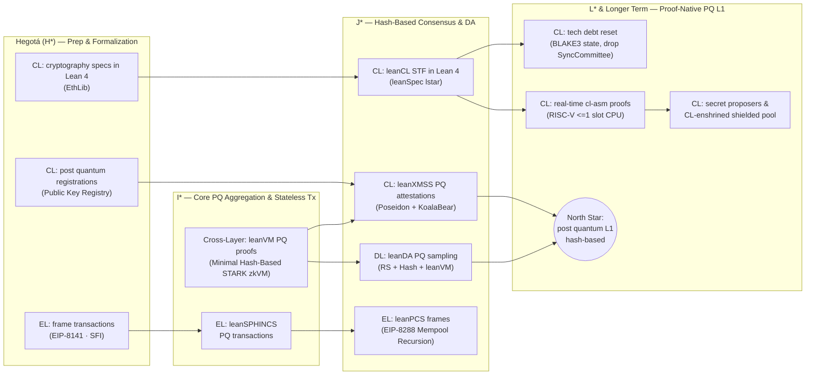

# Post-Quantum Threats & Ethereum's Solution Roadmap

> How a **Cryptographically Relevant Quantum Computer (CRQC)** breaks Ethereum's current cryptography across Consensus, Data Availability, and Execution — and how the **L1 Strawmap** ([strawmap.org](https://strawmap.org)) + local draft proposals ([consensus-specs](./consensus-specs)) migrate Ethereum to **hash-based post-quantum security (`post quantum L1`)**.

---

## 1. How Quantum Computers Break Current Ethereum

Quantum computers do **not** break all cryptography equally. They threaten Ethereum through two distinct algorithms:

1. **Shor's Algorithm (Catastrophic — Polynomial Time Break):** Solves the **Elliptic Curve Discrete Logarithm Problem (ECDLP)** and **pairing/hidden-subgroup problems** efficiently. Every elliptic-curve signature and polynomial commitment on Ethereum today falls completely once a CRQC exists.
2. **Grover's Algorithm (Moderate — Quadratic Speedup):** Speeds up unstructured preimage search from `2^n` to `2^(n/2)`. For 256-bit hashes (`SHA-256`, `Keccak-256`, `BLAKE3`, `Poseidon`), security drops from 256-bit to **~128-bit quantum security** — still cryptographically strong.

### 1.1 Vulnerability Audit of Current Ethereum Primitives

| Layer | Current Component | Cryptographic Primitive | Where in Workspace | Quantum Impact | Concrete Attack Scenario |
| :--- | :--- | :--- | :--- | :--- | :--- |
| **Consensus (CL)** | Validator keys, attestations, Sync Committees, ePBS bids/envelopes, FOCIL lists | **BLS12-381** (`BLS_SIG_BLS12381G2_XMD:SHA-256_SSWU_RO_POP_`) | [phase0/beacon-chain.md](./consensus-specs/specs/phase0/beacon-chain.md), [prysm/crypto/bls/blst](./prysm/crypto/bls/blst), [lighthouse/crypto/bls/src/impls/blst.rs](./lighthouse/crypto/bls/src/impls/blst.rs) | **BROKEN (Shor)** | `Validator.pubkey` (`BLSPubkey`) is public in `BeaconState`. Recovering `privkey` lets an attacker forge attestations, slash honest validators, finalize conflicting forks, and fake Sync Committee light-client updates. |
| **Consensus (CL)** | Block randomness (`randao_reveal`) | **BLS12-381** unique deterministic signature | [phase0/beacon-chain.md](./consensus-specs/specs/phase0/beacon-chain.md) | **BROKEN (Shor)** | Recovering proposers' BLS keys allows forging or pre-computing `randao_reveal` values and grinding proposer selection. |
| **Data (DL)** | EIP-4844 Blobs & **PeerDAS** (`128` custody columns) | **KZG** commitments & proofs over **BLS12-381** pairings | [deneb/beacon-chain.md](./consensus-specs/specs/deneb/beacon-chain.md), [fulu/das-core.md](./consensus-specs/specs/fulu/das-core.md), [fulu.yaml](./consensus-specs/presets/mainnet/fulu.yaml) | **BROKEN (Shor)** | Solving the discrete log of the Powers-of-Tau trusted setup recovers secret `tau`, allowing an attacker to forge valid `KZGProof`s for corrupted or withheld blob columns. |
| **Execution (EL)** | EOA transaction signatures, `EIP-7702` authorizations, `P-256` / `BN254` precompiles | **ECDSA (`secp256k1`)**, `secp256r1`, `alt_bn128` (`BN254`) pairings | EL execution clients (`ecrecover`, precompiles) | **BROKEN (Shor)** | Any address whose public key was ever revealed (any EOA with ≥1 outgoing tx, or **mempool front-running** while a first tx is pending!) can have its private key derived and funds drained. `BN254` pairings break Groth16/KZG rollup & bridge verifiers. |
| **All Layers** | State roots, block hashes, SSZ `hash_tree_root`, MPT, unspent address hashes | **SHA-256**, **Keccak-256**, Merkle trees | [phase0/beacon-chain.md](./consensus-specs/specs/phase0/beacon-chain.md) (`sha256`, `hash_tree_root`) | **SAFE (Grover only)** | Unspent EOA addresses (`keccak256(pk)[-20:]`) and `0x01`/`0x02` EL withdrawal credentials hide the public key behind a hash until spent, though key exposure in the mempool still creates a last-mile hijack risk. |

### 1.2 Why Replacing BLS & ECDSA Is Non-Trivial (The Three Bottlenecks)

Switching away from elliptic curves is not a drop-in swap because post-quantum signatures have fundamentally worse size and aggregation tradeoffs:

1. **No Native Algebraic Aggregation:** BLS12-381 lets thousands of validator signatures compress into a single `96-byte` signature (`bls.Aggregate`). Hash-based signatures cannot be summed algebraically.
2. **Kilobyte-Scale Signatures:** `secp256k1` ECDSA is `65 bytes` and `BLS12-381` is `96 bytes`, whereas PQ signatures (`XMSS`, `SPHINCS+`) range from **~1 KB to >10 KB+** (and STARK proofs can reach tens of KB), threatening L1 block size and gossip bandwidth.
3. **Stateful vs. Stateless Key Management:** Efficient **XMSS** signatures are *stateful* (reusing a one-time leaf index compromises security — fine for always-online consensus validators with strict slot indexes, dangerous for cold wallets/EOAs that need *stateless* `SPHINCS`).

---

## 2. Ethereum's Post-Quantum Solutions & L1 Strawmap Roadmap

To solve size, aggregation, verification cost, and key-migration friction simultaneously, Ethereum unifies **all three layers (`CL`, `DL`, `EL`)** around **hash-based cryptography** and **recursive STARK proofs (`leanVM`)**, converging on the Strawmap North Star **`post quantum L1` (`hash-based`)**.

---

## 3. Layer-by-Layer Solution Breakdown

### 3.1 Cross-Layer Foundation: `leanVM` (`I*` · `⚛`)
- **Strawmap Link:** [github.com/leanEthereum/leanVM](https://github.com/leanEthereum/leanVM)
- **What It Solves:** Replaces BLS algebraic signature aggregation and trusted KZG polynomial commitments with **recursive hash-based STARK proofs** over small prime fields (KoalaBear).
- **Reported README Benchmarks:**
  - `leanXMSS` aggregation: **`1,600 sigs/s`**
  - `leanSPHINCS` aggregation: **`500 sigs/s`**
  - `leanDA` commitment: **`3.2 MiB/s`**
  - 2-to-1 proof recursion: **`140 ms`** · `KECCAK` proving: **`700K/s`**
- **Role in Roadmap:** Acts as the shared cryptographic workhorse feeding **`leanXMSS` (CL)**, **`leanDA` (DL)**, and **`tech debt reset`** aggregation cleanups.

### 3.2 Consensus Layer (`CL`) Solutions

1. **Phased Migration via `post quantum registrations` (`Hegotá` · `⚛`)**
   - *Link:* [Exploring the design space for a post-quantum public key registry](https://ethresear.ch/t/exploring-the-design-space-for-a-post-quantum-public-key-registry-for-ethereum-validators/25040)
   - *How it works:* Decouples **key registration** from **consensus enforcement**. Validators register PQ public keys (e.g., `leanXMSS`) on-chain ahead of time using standard deposit/validator workflows so the network avoids an emergency cold-storage "flag day" when BLS verification is later turned off.
2. **PQ Hash-Chain RANDAO (`EIP-8321` — Already Prototyped Locally)**
   - *Local Spec:* [consensus-specs/specs/_features/eip8321/beacon-chain.md](./consensus-specs/specs/_features/eip8321/beacon-chain.md)
   - *How it works:* Replaces BLS-signature `randao_reveal` with a per-validator **`blake3` hash chain** (`RandaoCommitmentRegistration`). Proposers reveal the preimage of their stored 32-byte commitment, which is verified via `verify_hash_chain_reveal` and becomes the new stored tip. Collision resistance replaces BLS uniqueness, and preimage resistance prevents proposer grinding — both quantum-safe.
3. **`leanXMSS PQ attestations` (`J*` · `⚛`)**
   - *Link:* [leanSpec XMSS module](https://github.com/leanEthereum/leanSpec/tree/main/src/lean_spec/spec/crypto/xmss)
   - *How it works:* Replaces BLS validator attestation signatures with **Generalized XMSS**, a *stateful* hash-based signature scheme tailored to fixed consensus slots:
     - Uses **Poseidon** over the **KoalaBear** prime field (`P`), Winternitz target-sum encoding (`PROD_CONFIG`: `LOG_LIFETIME=32`, `DIMENSION=46`, `BASE=8`, `TARGET_SUM=200`).
     - Splits key lifetime (`2^32` slots) into `sqrt(lifetime)` bottom Merkle trees (`_expand_activation_time`), ensuring each slot uses a fresh one-time key index.
     - Thousands of `leanXMSS` attestations are recursively compressed by **`leanVM`** and paired with **`decoupled consensus`** (`I*`) / attester-set sizing so slots stay fast.
4. **Formal Specs (`H*`–`J*`), `tech debt reset` & `real-time cl-asm proofs` (`L*`)**
   - *Links:* [EthLib (Lean 4 crypto specs)](https://github.com/ethereum/cryptography-specs), [leanSpec](https://github.com/leanEthereum/leanSpec), [tech debt reset](https://notes.ethereum.org/@JustinDrake/BkPH7AXSfl), [cl-asm proofs](https://notes.ethereum.org/A47R_en0TVqAiE_5c_r4bA?view)
   - *How it works:* Refactors the CL STF for SNARK-friendliness (replacing SHA-256 with BLAKE3-style hashes, removing the BLS `SyncCommittee` and legacy deposit contract, unifying aggregation under `leanVM` recursion, and capping/restructuring attesters). A RISC-V guest (`cl-asm`) formally proven equivalent to the Lean 4 spec generates full CL validity proofs in **<= 1 slot on a laptop CPU**, enabling trustless light clients, **SSLE (`secret proposers`)**, and a **`CL-enshrined shielded pool`** ([The Extremely Lean Chain](https://ethresear.ch/t/the-extremely-lean-chain/25369#p-61091-phase-2-privacy-7)).

### 3.3 Data Layer (`DL`) Solution: `leanDA PQ sampling` (`J*` · `⚛`)
- **Strawmap Link:** [LeanDA: Design and Benchmark](https://ethresear.ch/t/leanda-design-and-benchmark/25642)
- **What It Replaces:** KZG polynomial commitments & proofs (`KZGCommitment`, `KZGProof` over `BLS12-381`) in EIP-4844 and PeerDAS.
- **How It Works ("Encode + Prove"):**
  1. Builders apply **Reed-Solomon (RS) erasure coding** to blob matrices and commit to columns/cells using **hash-based vector commitments** (Merkle trees — completely quantum-safe).
  2. Builders generate a **`leanVM` STARK proof** certifying that the committed matrix rows actually form valid Reed-Solomon codewords (via barycentric/parity checks).
  3. Light nodes continue doing random **PeerDAS-style data availability sampling**, verifying Merkle openings + the compact STARK proof rather than BLS12-381 pairings.

### 3.4 Execution Layer (`EL`) Solutions
1. **`frame transactions` (`H*`, `SFI`, `EIP-8141`) — Native Account Abstraction Off-Ramp**
   - *Link:* [EIP-8141](https://eips.ethereum.org/EIPS/eip-8141)
   - *How it works:* Introduces transaction type `0x06` splitting validation (`VERIFY` frames), gas approval (`APPROVE`), and execution (`SENDER` frames). Accounts are **decoupled from hardcoded `secp256k1` ECDSA**, allowing wallets to migrate cleanly to quantum-resistant signature checks inside `VERIFY` frames without protocol-level forks for every new scheme.
2. **`leanSPHINCS PQ transactions` (`I*` · `⚛`)**
   - *How it works:* Unlike validators (which run continuously and safely track `leanXMSS` state per slot), user wallets and hardware signers need **stateless** signatures so backing up or restoring a seed phrase never causes catastrophic one-time-key reuse. `leanSPHINCS` trims SPHINCS+ parameters specifically for EVM verification and low calldata footprint.
3. **`leanPCS frames` (`J*`, `EIP-8288`) — In-Mempool Recursive Aggregation**
   - *Link:* [EIP-8288](https://eips.ethereum.org/EIPS/eip-8288)
   - *How it works:* Because PQ signatures (`leanSPHINCS`) and user ZK proofs are 1–128 KB each, submitting them raw in L1 blocks would exhaust block space. **EIP-8288** lets mempool/builder nodes **recursively aggregate** transaction signatures and validation proofs using **`leanPCS`** (a small-field polynomial commitment scheme that avoids locking Ethereum into a single VM ISA), placing only a **single compact master proof** on-chain per block.
4. **Longer-Term EL Hardening:** **`pureth purges`** (`K*`), **`evm-asm` canonical zkEVM** (`EIP-8025` optional execution proofs in [specs/_features/eip8025/](./consensus-specs/specs/_features/eip8025) → mandatory 1-of-1 proofs), and **`private L1` shielded transfers** replace legacy elliptic-curve assumptions across state execution and verification.

---

## 4. Workspace Readiness vs. Remaining Migration Gap

| Area | Current State in Workspace | PQ Migration Status |
| :--- | :--- | :--- |
| **CL Validator Signatures** | `BLS12-381` (`blst`) in [consensus-specs](./consensus-specs), [prysm](./prysm), [lighthouse](./lighthouse), [zrnt](./zrnt) | **0% PQ in clients** (`Hegotá` PQ registry & `J*` `leanXMSS` not yet in `specs/heze/` or clients). |
| **CL RANDAO** | BLS signature reveal in `process_randao` | **Draft spec exists locally** in [specs/_features/eip8321/](./consensus-specs/specs/_features/eip8321) (`blake3` hash-chain commit-reveal); absent in clients. |
| **CL/EL Execution Proofs** | Inline/Gloas EL execution without mandatory ZK proofs | **Draft spec exists locally** in [specs/_features/eip8025/](./consensus-specs/specs/_features/eip8025) (optional non-consensus execution proofs on Gloas); `cl-asm` & `leanVM` not in workspace. |
| **Data Availability (DA)** | BLS12-381 KZG commitments in `deneb/` & 128-column PeerDAS in `fulu/das-core.md` | **0% PQ in workspace** (`leanDA` RS + hash + `leanVM` is research stage). |
| **EL Accounts & Mempool** | ECDSA `secp256k1` EOAs (`EIP-7702` adds temporary delegation) | **Strawmap SFI/EIP**: `EIP-8141` Frame Txs (`H*`) → `leanSPHINCS` (`I*`) → `EIP-8288` `leanPCS` (`J*`). |
